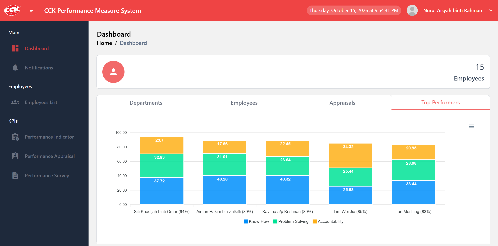
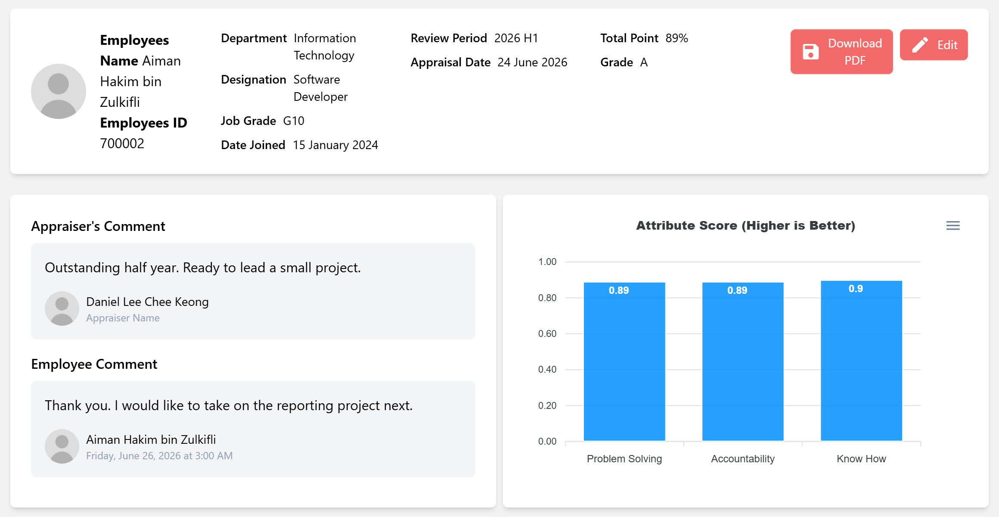
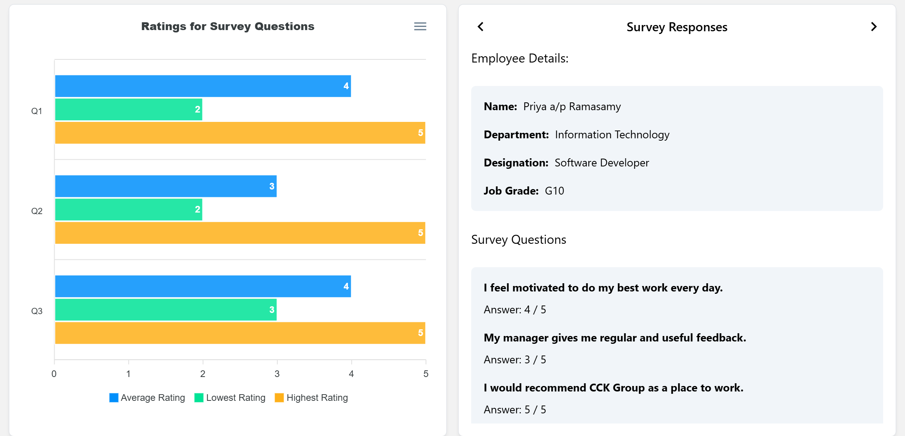

# CCK HR Performance Measure System

**How can HR run consistent performance appraisals across every department?** A web app built for CCK Group as a final-year software engineering project, covering employees, appraisals and staff surveys in one place.

HR sets the scoring criteria for each designation and job grade. Heads of department appraise their staff, employees read and comment on their own results, and every appraisal can be downloaded as a PDF. It deploys as a single Node.js app, or with one Docker command that includes the database.



## What it does

- **Everyone in a role is scored the same way.** Each job grade splits 100% across Know-How, Problem-Solving and Accountability, and each criterion's sub-items are weighted to 100%. A total of 85 or more is an A, whoever gave it.
- **Access follows the org chart.** Four roles (Super Admin, HR, HOD, Employee) map to 30 permissions. Heads of department see only their own department's staff and appraisals.
- **Surveys reach staff by email.** HR sends 1–5 rating campaigns to chosen employees, who can answer from an emailed link without logging in. Results show the average and spread for each question.
- **The dashboard shows the company at a glance:** headcount by department, staff growth, appraisals per month and the top five performers.

## Highlights

- **One app to deploy.** The Express server serves the React site and the API from one port, creates its default roles on first start, and asks for the first admin account on the first visit.
- **Improved after reviewing the original version.** The original group project let anyone edit any account without logging in and created some accounts that could never log in. A later rewrite also let one malformed cookie crash the server. These are fixed and re-tested. See [Version history](docs/technical.md#version-history).
- **Ready for local language use.** The interface is available in English, Bahasa Melayu and Chinese.

**Tech stack:** React 18, Vite, Tailwind CSS, Chart.js, ApexCharts, Recharts, Node.js, Express, MongoDB (Mongoose), JWT cookies, bcrypt, Puppeteer, Nodemailer, Docker.

## The app

| Appraisals | Surveys | Administration |
|---|---|---|
| Score an employee against the criteria for their designation and job grade. The total and grade (A–E) are worked out for you, the employee can add a comment, and the result downloads as a PDF. | Build a campaign with your own questions and rating labels, pick the employees, and follow who has responded. Download every response as PDFs in one zip. | Manage departments, designations, job grades and employees (one at a time or by CSV), and choose what each role can see and do. |

<p>
  
  
</p>

The screenshots use generated demo data with fictional people.

## Run it

Needs Docker, or Node.js 18+ with MongoDB.

```bash
cp server/.env.example server/.env   # then set JWT_SECRET in server/.env

docker compose up -d --build         # with Docker (includes MongoDB)

npm run install:all                  # or with Node.js and your own MongoDB
npm run build
npm start
```

Open http://localhost:3000. The first visit asks you to create the admin account. Settings, email, production deployment and development mode are in [docs/technical.md](docs/technical.md#deployment).

## Test data

`npm run seed:mock` adds a small test set: one HR, one head of department and two employee accounts in 2 departments, 5 appraisals and an open survey. Log in as `hr@mock.cck.test`, `hod@mock.cck.test` or `employee@mock.cck.test` with the password `Password123`. `npm run seed:mock:clear` removes exactly those records and nothing else. More in [docs/technical.md](docs/technical.md#test-data).

## Limitations

- **Translations**: the Malay and Chinese server messages haven't been checked by a native speaker.
- **Email**: invitations and appraisal PDFs are only emailed once an SMTP provider or Gmail app password is set.
- **Large lists**: some pages load every record at once, so they will slow down with thousands of records.
- **Tests**: there is no automated test suite yet.

**Next steps** that would improve it: an automated test suite, building the Docker image in CI, and paging for large lists.

How it works, scoring, deployment, settings, project layout, known issues and version history: [docs/technical.md](docs/technical.md)
